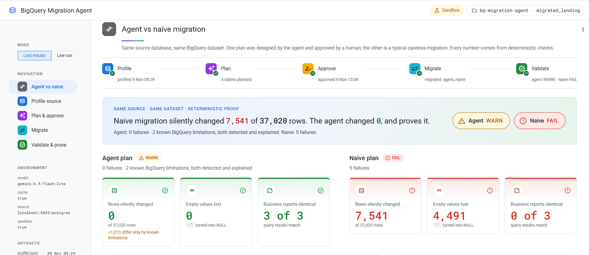
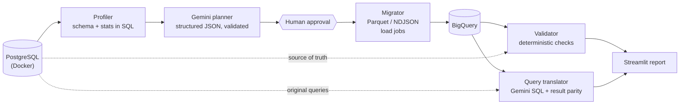
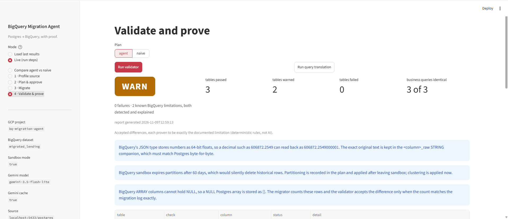
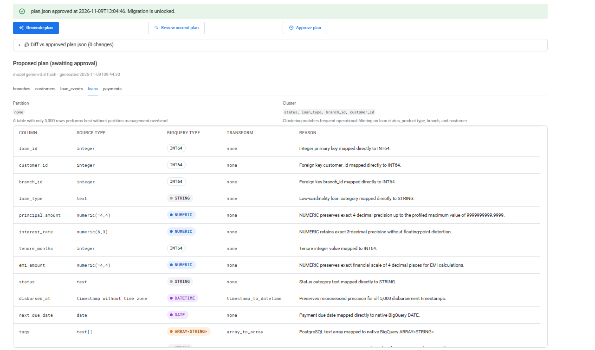

# BigQuery Migration Agent

**An AI-assisted PostgreSQL → BigQuery migration that proves its own correctness, row by row, with deterministic checks.**

Running a migration is easy: export, load, done. Proving it is correct is the hard part. Money can drift through floating point, empty strings can quietly become NULL, timestamps can lose microseconds, and BigQuery's type system has edge cases that silently change data. This project migrates a deliberately messy legacy lending database twice, once with an agent-designed and human-approved plan and once the "typical" careless way. It then proves which migration is correct using exact, reproducible checks, not AI judgment.

## Headline results

Same source (5 tables, 37,020 rows), same BigQuery dataset, two plans:

| Metric | Agent plan | Naive plan |
|---|---|---|
| Tables passed · warned · failed | ✅ 3 passed · 2 warned · 0 failed | ❌ 0 passed · 0 warned · 5 failed |
| Money columns with SUM drift | ✅ 0 of 5 | ❌ 5 of 5 |
| Empty strings lost (`''` → NULL) | ✅ 0 | ❌ 4,491 |
| Type downgrades | ✅ 0 | ❌ 14 |
| Rows with changed values | ✅ 0 of 37,020 | ❌ 7,541 of 37,020 |
| Business queries identical | ✅ 3 of 3 | ❌ 0 of 3 |

The agent plan's status is **WARN, not PASS**: 2 known BigQuery limitations are detected, proven and explained (see below). The 1,013 rows they affect are counted separately, not hidden.



## Architecture



## What it caught

| Trap | What happens | How it is handled |
|---|---|---|
| **Float drift on money** | `NUMERIC(14,4)` → `FLOAT64` makes `SUM(principal_amount)` 26902369751.78846 instead of 26902369751.7884 | Money → `NUMERIC`; SUM/MIN/MAX compared as exact decimals, no tolerance |
| **`''` → NULL** | 4,491 empty strings across 8 columns silently become NULL, so `COALESCE`/`NULLIF` logic changes | Empty strings kept as-is; NULL and `''` counted separately on both sides |
| **BigQuery JSON stores numbers as FLOAT64** | `606872.2549` inside `jsonb` reads back as `606872.2549000001` | Exact `<col>_raw` STRING companion; the JSON difference is WARN **only if** `_raw` matches Postgres byte-for-byte, otherwise FAIL |
| **NULL arrays become empty arrays** | BigQuery `ARRAY` cannot be NULL: 1,012 NULL `tags` load as `[]` | Migrator logs the count; WARN only if the validator finds exactly that many |
| **Sandbox partition expiry** | Sandbox expires partitions after 60 days, which would delete 2021–2026 history on load | Partitioning planned but deferred in sandbox (INFO); clustering applied |
| **Parquet can't load JSON columns** | Load job fails: `Unsupported field type: JSON` | NDJSON load job for tables with JSON; NULLs omitted so they stay SQL NULL, not JSON `null` |

Every row is fingerprinted (MD5 of values canonicalized by *source* type) and joined on the primary key. A type-fidelity check flags any downgrade (e.g. `numeric` → `FLOAT64`, `timestamp` → `STRING`).



## Design principles

- **AI proposes, a human approves, deterministic code verifies.** Gemini writes `plan_proposed.json`; only an approved `plan.json` (with `approved_at`) can be migrated.
- **Gemini output is structured JSON, validated before use:** pydantic schema, plus rule checks (money never `FLOAT64`, every column exactly once, JSON gets a `_raw` companion), with one retry carrying the errors.
- **AI explanations are advisory.** They are generated after the deterministic verdict, stored under a labeled `ai_explanations` section, and never change a status.
- **Gemini response cache** (`.cache/gemini/`, keyed on model + prompt + contents + schema): re-runs are free and reproducible. A daily-quota error fails fast and never overwrites saved results.
- **BigQuery sandbox-safe:** load jobs only, no streaming inserts, no DML.



## Tech stack

Python (tested on 3.13) · PostgreSQL 16 (Docker) · BigQuery (sandbox) · google-cloud-bigquery · Gemini via google-genai (AI Studio key) · pydantic · pyarrow (Parquet) · pandas · psycopg2 · Streamlit · Faker

## How to run

**1. Setup** (Windows PowerShell; on macOS/Linux use `source .venv/bin/activate`)

```powershell
docker run -d --name legacy-pg -e POSTGRES_PASSWORD=<password> -p 5433:5432 postgres:16
python -m venv .venv
.\.venv\Scripts\Activate.ps1
pip install -r requirements.txt
gcloud auth application-default login
```

Create `.env` in the project root (copy `.env.example`):

```ini
PG_HOST=localhost
PG_PORT=5433
PG_USER=postgres
PG_PASSWORD=<password>
PG_DB=postgres
GCP_PROJECT=<your-gcp-project>
BQ_DATASET=migrated_lending
BQ_SANDBOX=true
GEMINI_API_KEY=<ai-studio-key>
GEMINI_MODEL=gemini-3.5-flash-lite
GEMINI_CACHE=true
```

**2. Pipeline** (each step can also be run from the app)

```powershell
python seed/create_legacy_db.py              # messy legacy DB with migration traps
python -m agent.profiler                     # -> profile.json
python -m agent.planner                      # -> plan_proposed.json + naive_plan.json
python -m agent.planner --approve            # human approval -> plan.json
python -m agent.migrator --plan agent        # -> agent_* tables (also: --plan naive)
python -m agent.validator --plan agent       # -> report_agent.json, exit 1 on FAIL
python -m agent.translator --plan agent      # query parity, added to the report
```

Optional flags:

- `python -m agent.planner --amend-raw` adds the exact `<col>_raw` STRING companions for JSON columns to an existing `plan.json`, without calling Gemini.
- `--tables <name> ...` (migrator, validator) runs only the listed source tables.
- `--no-ai` (validator) skips the advisory Gemini explanations; the deterministic verdict is unchanged.

**3. UI**

```powershell
streamlit run app.py
```

Try the UI instantly with the bundled sample results. "Last results" mode (sidebar) only reads saved JSON artifacts (no database, BigQuery or Gemini calls), and falls back to `samples/` when you haven't run the pipeline yet. After your own run, `python -m agent.samples` refreshes `samples/`; it replaces the GCP project ID with a placeholder and refuses to write if it finds a secret.

## Project structure

```
seed/create_legacy_db.py    messy NBFC lending DB (Faker, en_IN) with deliberate traps
seed/business_queries.sql   legacy Postgres reporting queries to translate
agent/profiler.py           schema, keys and per-column stats, computed in SQL
agent/planner.py            Gemini plan (JSON, validated), naive plan, approval, cache
agent/migrator.py           server-side cursor -> Parquet/NDJSON -> BigQuery load jobs
agent/validator.py          deterministic checks + row fingerprints -> report_<plan>.json
agent/translator.py         Gemini SQL translation, dry run, result parity
agent/compare.py            read-only views over the JSON artifacts for the UI
agent/samples.py            refreshes samples/ (sanitized copies of the latest results)
app.py                      Streamlit: profile -> plan & approve -> migrate -> prove
samples/                    bundled results, so the UI works without running anything
docs/                       screenshots
```

## What I'd do next

- **Cloud SQL for PostgreSQL** as the source, connected through the Cloud SQL connector.
- **Vertex AI** instead of an AI Studio key: IAM auth, VPC-SC, regional endpoints.
- **Terraform** for the dataset, service accounts and IAM.
- **Cloud Run** deployment of the app and pipeline (Cloud Run Jobs for migrations).
- **Partitioning outside sandbox:** apply the planned, already-recorded partition columns.
- **Scale to 1,000+ tables:** parallel extracts and load jobs, plus sampled fingerprints with exact aggregates for very large tables.
- **Incremental / CDC sync** (Datastream) with continuous validation until cutover.

## License

MIT, see [LICENSE](LICENSE).
